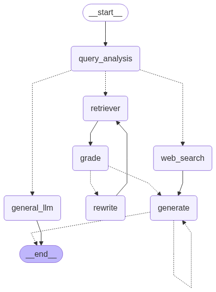

# Adaptive RAG Chatbot

An agentic RAG chatbot built with LangGraph. Each question is classified and sent down one of three paths: search the uploaded documents, answer from the LLM's general knowledge, or search the web. Answers from the document path are graded for relevance, and the query is rewritten and retried when the retrieved context does not fit.

The backend is a FastAPI app. A Streamlit app provides chat and document upload. Chat history is stored in MongoDB per session.

## Architecture

```
Streamlit app (streamlit_app/)
        |
        v
FastAPI (src/main.py, src/api/routes.py)
  POST /rag/query             POST /rag/documents/upload
        |                              |
        v                              v
LangGraph graph               load PDF/TXT, split into chunks,
(src/rag/graph_builder.py)    embed, store in FAISS
        |
        +--> retriever (FAISS) --> grade --> generate
        |                            |
        |                            +--> rewrite --> retriever
        +--> general_llm
        +--> web_search (Tavily) --> generate

MongoDB: chat history per session_id
```

The graph as rendered by LangGraph:



The dashed loop on `generate` in the image is an answer verification step (`verify_answer` in `src/tools/graph_tools.py`). It is defined in the code but not wired into the current graph.

## How routing and grading work

1. **query_analysis** pulls context for the question from the vector store, then asks the LLM to classify the question as `index`, `general` or `search` (structured output, `src/models/route_identifier.py`). The classifier prompt is in `src/config/prompts.yaml`.
2. `routing_tool` sends `index` to **retriever**, `general` to **general_llm** and `search` to **web_search**.
3. **retriever** runs a ReAct agent (at most 2 iterations) whose tool searches the uploaded documents.
4. **grade** asks the LLM for a yes/no relevance score on what came back (`src/models/grade.py`).
5. `doc_tool` sends `yes` to **generate**, which writes the final answer. A `no` goes to **rewrite**, which rewrites the query and sends it back to **retriever**.
6. **web_search** calls Tavily and passes the result text to **generate**. **general_llm** answers directly and ends the run.

## Document upload

`POST /rag/documents/upload` accepts a PDF or TXT file and an `X-Description` header. Other file types get a 400.

- The file is loaded with `PyPDFLoader` or `TextLoader` and split into 1000 character chunks with 150 characters of overlap.
- The description is rewritten by the LLM into a tool instruction and saved to `description.txt` in the working directory. The retriever tool uses it to decide which questions belong to the documents.
- Chunks are embedded with OpenAI embeddings and stored in an in-memory FAISS index. Each upload builds a new index, and the index is lost on restart.

The Qdrant code is still in `src/rag/retriever_setup.py`, commented out. [docs/qdrant-setup.md](docs/qdrant-setup.md) explains how to switch to it.

## Models

| Where | Model | File |
|---|---|---|
| Graph nodes (classify, grade, rewrite, generate, general answers) | Groq `gemma2-9b-it` | `src/llms/groq.py` |
| ReAct retrieval agent and description rewrite | OpenAI `gpt-4o` | `src/llms/openai.py` |
| Embeddings | `OpenAIEmbeddings` | `src/rag/retriever_setup.py` |

`src/llms/huggingface.py` sets up `HuggingFaceTB/SmolLM3-3B` through `transformers` as a local alternative. It also needs `torch`, which is not in `requirements.txt`.

## Setup

You need Python 3, a MongoDB server on `localhost:27017` and API keys for OpenAI, Groq and Tavily.

```bash
git clone https://github.com/Uditp11/RAG_Adaptive.git
cd RAG_Adaptive
python -m venv venv
source venv/bin/activate   # Windows: venv\Scripts\activate
pip install -r requirements.txt
```

Create a `.env` file in the project root (it is ignored by git):

```env
OPENAI_API_KEY=your_openai_key
GROQ_API_KEY=your_groq_key
TAVILY_API_KEY=your_tavily_key

# Only read when the Qdrant code is enabled
QDRANT_URL=
QDRANT_API_KEY=
QDRANT_CODE_COLLECTION=codebase
QDRANT_DOCS_COLLECTION=guidelines
```

The MongoDB address and database name (`adaptive_rag`) are set in `src/db/mongo_client.py`.

## Run

```bash
# API on http://localhost:8000 (interactive docs at /docs)
python -m uvicorn src.main:app --reload --port 8000

# Streamlit app on http://localhost:8501
streamlit run streamlit_app/home.py
```

The Streamlit login and sign up page calls a separate auth service at `http://localhost:8080/api`, which is not part of this repository. Without it you can still use the API directly:

```bash
curl -X POST http://localhost:8000/rag/documents/upload \
  -H "X-Description: Notes about Python" \
  -F "file=@notes.pdf"

curl -X POST http://localhost:8000/rag/query \
  -H "Content-Type: application/json" \
  -d '{"query": "What do the notes say about decorators?", "session_id": "user_123"}'
```

The query response is the last message of the graph run, for example `{"result": {"type": "ai", "content": "..."}}`.

## Project structure

```
src/
  main.py            FastAPI app
  api/routes.py      /rag/query and /rag/documents/upload
  config/            prompts.yaml and the loader for it
  core/              environment settings, logger
  db/                MongoDB client
  llms/              Groq, OpenAI and Hugging Face model setup
  memory/            MongoDB chat history (and an in-memory version)
  models/            graph state and structured output schemas
  rag/               graph, ReAct agent, retriever, document upload
  tools/             routing, grading and description helpers
streamlit_app/       login page, chat page, API client
docs/qdrant-setup.md switching the vector store from FAISS to Qdrant
```

## License

MIT. See [LICENSE](LICENSE).

## Author

**Udit Parihar**
- GitHub: [@Uditp11](https://github.com/Uditp11)
- Project: [RAG_Adaptive](https://github.com/Uditp11/RAG_Adaptive)
